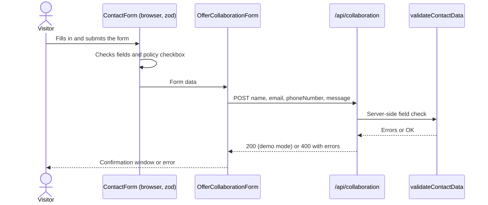

# Contact form: feature analysis and changes (example)

> FALLBACK EXAMPLE for Day 2. Compiled from the lf-client template code, checked manually: `app/constants/validation.ts`, `app/lib/utils/validateContactData.ts`, `app/api/contact/route.ts`, `app/api/collaboration/route.ts`, `app/shared/components/forms/contact-form/ContactForm.tsx`, `app/shared/components/forms/offer-collaboration-form/OfferCollaborationForm.tsx`, `app/services/email/emailService.ts`. Line numbers are not given: they change. Aligned with the current Day 2 instruction (IDs, three-state rules, AC with RULE-IDs, questions with owners). Read it, verify it against the code and **add your own corrections** (see `fallback/en/README.md`). The "stakeholder" answers below are invented for the simulation (mentor script).

## 1. Short description and original request

The Foundation receives visitor enquiries through a form (name, email, phone, message, consent to the privacy policy). The form is on the "Contacts" page and in the partnership block.

**Original request (issue, verbatim, never overwrite):**

> We want to tighten up the contact form. Phone number should be mandatory. We should also let visitors attach a document (CV or portfolio) when they write to us. Notifications need to reflect the new field.

**What the code shows:**
- Phone is optional both on the server and in the browser.
- There are no attachments in the form or in the API.
- No notification email is built: `emailService` is never called, and the API only returns "success" in demo mode.
- The form on the "Contacts" page posts to `/api/collaboration`, while `/api/contact` is not called by any page. In `GetNotesModal` the same form does not call the API at all.

## 2. Business context (from the stakeholder simulation)

Status of all rows: **Agreed with the simulation** (the answers are invented by the mentor; in a real project they must be confirmed).

| What | Value | Source |
|---|---|---|
| Goal | Call back about performance rights: emails get lost | stakeholder answer |
| Success metric | Share of enquiries answered within 2 working days: now ≈50 %, target 90 % | stakeholder answer |
| NFR-01 (privacy) | Phone and CV are personal data: keep no longer than 6 months, access for two employees only | stakeholder answer |
| NFR-02 (files) | PDF only, up to 5 MB | stakeholder answer |
| NFR-03 (languages) | Errors in the visitor's interface language | stakeholder answer |
| Not defined | Virus scanning of files: the stakeholder "did not think about it" → open question Q-07 | stakeholder answer |

## 3. User stories

1. **As** a visitor, **I want** to give my phone number, **so that** the Foundation can call me back.
2. **As** a visitor, **I want** to attach a CV or portfolio to my enquiry, **so that** the Foundation sees my materials at once.
3. **As** a Foundation employee, **I want** to receive a notification with the phone and a link to the attachment, **so that** I can process enquiries quickly.

## 4. Data flow diagram

Note: the request has no `policy` field (consent to the policy); the server knows nothing about it.

## 5. Rules table (three states)

Three states: **"Is now"** (what the code does), **"Should be"** (what the business decided) and **"Who decided"**. An empty "Should be" means there is no decision: it is a question, not an invention.

| ID | Rule | File | Source of truth | Layer | Is now | Should be | Who decided |
|---|---|---|---|---|---|---|---|
| RULE-01 | Name | `validation.ts`, `validateContactData.ts`; `ContactForm.tsx` | constant / number in the zod schema | API and UI | 2–50 characters, `maxLength 50` | unchanged | not affected by the request |
| RULE-02 | Email | `validateContactData.ts` (`EMAIL_PATTERN`); `ContactForm.tsx` (`.email()`) | regular expression / zod schema | API and UI | **two different rules** | ? | open, Q-09 |
| RULE-03 | Phone | `validateContactData.ts` (`PHONE_NUMBER_PATTERN`); `ContactForm.tsx`, `normalizePhoneNumberFromMask` | regular expression and constants / zod schema | API and UI | optional; if present, `+` and digits, 11–16 | mandatory; format unchanged | stakeholder (issue); for `GetNotesModal` ? (Q-04) |
| RULE-04 | Message | `validation.ts`, `validateContactData.ts`; `ContactForm.tsx`, `i18n/messages` | constant / numbers in the schema and translations | API and UI | 10–1000 characters | unchanged | not affected by the request |
| RULE-05 | Consent to the policy | `ContactForm.tsx` | zod schema | **UI only** | mandatory in the browser, the server does not know about it | ? | open, Q-08 |
| RULE-06 | Attachment | no new files (`upload.ts` is only a demo stub) | none | UI, API, storage | none | optional, PDF only, up to 5 MB | stakeholder (simulation); storage, viruses, privacy open (Q-01, Q-02, Q-07, Q-10) |
| RULE-07 | Notification about an enquiry | `emailService.ts` (not called) | stub | API, external mail service | no email is built | contains the phone and a link to the attachment | issue; channel and recipient open (Q-03) |
| RULE-08 | Accepting the request | `app/api/collaboration/route.ts` | hard-coded text | API | demo "success", nothing is stored | ? | open |
| RULE-09 | State of the "Send" button | `ContactForm.tsx` (`disabled`) | component property | UI | disabled only while sending | ? | open, Q-05 |
| RULE-10 | Request rate limiting | `app/api/*` | none | API | not found in the files reviewed | ? | open, Q-06 |
| RULE-11 | Maximum length message | `useAutoHideMessage` | hook | UI | disappears automatically | unchanged | not affected by the request |

## 6. Acceptance criteria (for the change from the issue)

Format: `AC-NN | Given … When … Then … | RULE-ID`. Numeric limits (PDF, 5 MB) come from the stakeholder conversation; anything the stakeholder did not define is in the open questions. Each AC describes **new** behaviour and passes the AC linter (atomic, one result, no implementation or vague words, testable).

1. **AC-01** | **Given** the form is open, **When** the user leaves the phone empty and clicks "Send", **Then** a "phone is required" error is shown and no request is sent. | RULE-03
2. **AC-02** | **Given** the phone is entered in a wrong format (no `+` or shorter than 11 characters), **When** the user submits the form, **Then** a phone format error is shown. | RULE-03
3. **AC-03** | **Given** the phone is entered correctly, **When** the user submits the form, **Then** the request is sent. | RULE-03
4. **AC-04** | **Given** the user chose a PDF up to 5 MB, **When** they submit the form, **Then** the attachment is sent together with the request. | RULE-06
5. **AC-05** | **Given** the user chose a file over 5 MB, **When** they choose it, **Then** a size error is shown and the file is not added. | RULE-06
6. **AC-06** | **Given** the user chose a non-PDF file, **When** they choose it, **Then** a file type error is shown. | RULE-06
7. **AC-07** | **Given** no file is chosen, **When** the user submits the form, **Then** the request is sent without an attachment. | RULE-06
8. **AC-08** | **Given** consent to the policy is not checked, **When** the user clicks "Send", **Then** the form is not submitted. | RULE-05
9. **AC-09** | **Given** the form is being sent, **When** the request is still in progress, **Then** the "Send" button is disabled until the request finishes. | RULE-09 (behaviour for invalid fields is decided by Q-05)
10. **AC-10** | **Given** an enquiry is successfully accepted, **When** the Foundation receives the notification, **Then** it contains the phone and a link to the attachment. | RULE-07 (channel decided by Q-03)
11. **AC-11** | **Given** the interface is in Ukrainian or English, **When** an error is shown, **Then** it is written in the interface language. | RULE-03, RULE-06, NFR-03
12. **AC-12** | **Given** an attachment was stored more than 6 months ago, **When** the cleanup runs, **Then** the file is deleted. | RULE-06, NFR-01 (mechanism decided by Q-02)

> What the linter fixed: in the draft, AC-09 and AC-10 described current behaviour ("now the button…", "now no email is built"); they now describe the new behaviour, and the current state lives in the rules table (RULE-07, RULE-09).

## 7. Key files table

| File | Why |
|---|---|
| `app/shared/components/forms/contact-form/ContactForm.tsx` | The form and rules in the browser |
| `app/shared/components/forms/offer-collaboration-form/OfferCollaborationForm.tsx` | Sends data to `/api/collaboration` |
| `app/api/collaboration/route.ts` | Accepts the request from the form (demo) |
| `app/api/contact/route.ts` | The same check, but nobody calls it |
| `app/lib/utils/validateContactData.ts` | Rules on the server |
| `app/constants/validation.ts`, `app/constants/errors.ts` | Limits and error texts on the server |
| `app/services/email/emailService.ts` | Email stub, not used anywhere |
| `app/services/upload/upload.ts` | Demo upload stub |
| `i18n/messages/en.json`, `uk.json` | Error and label texts |

## 8. Open questions for the stakeholder

Format: `Q-NN | question | why it blocks | owner (role) | by when | related`. Dates are indicative: in a real project the analyst agrees them with the stakeholder.

| ID | Question | Why it blocks | Owner (role) | By | Related |
|---|---|---|---|---|---|
| Q-01 | Where is the attachment stored (disk, cloud storage, email only)? | upload and link cannot be designed without it | tech lead | before development starts | RULE-06, AC-04, AC-10 |
| Q-02 | How do we implement privacy: storage up to 6 months, access for two employees? | legal risk, affects storage | personal data officer | before development starts | NFR-01, AC-12 |
| Q-03 | Who receives the notification and through which channel? | recipient not defined | head of the enquiries team | before development starts | RULE-07, AC-10 |
| Q-04 | Is the phone also mandatory in `GetNotesModal`, or only on "Contacts"? | changes the scope | product owner | before development starts | RULE-03, AC-01 |
| Q-05 | Should the button be disabled while fields are invalid? | affects AC-09 | UX designer | before design review | RULE-09, AC-09 |
| Q-06 | Do we need spam protection and request rate limiting? | open risk | tech lead | before development starts | RULE-10 |
| Q-07 | Should files be scanned for viruses? (the stakeholder "did not think about it") | security risk | security / tech lead | before development starts | RULE-06 |
| Q-08 | Should consent to the policy also be checked on the server? | a direct API request bypasses it today | legal / product owner | before development starts | RULE-05, AC-08 |
| Q-09 | Should the email format in the form and on the server match? | two different rules today | tech lead | before development starts | RULE-02 |
| Q-10 | What should happen if the file upload is interrupted? | no behaviour for failure | UX designer | before design review | RULE-06 |
