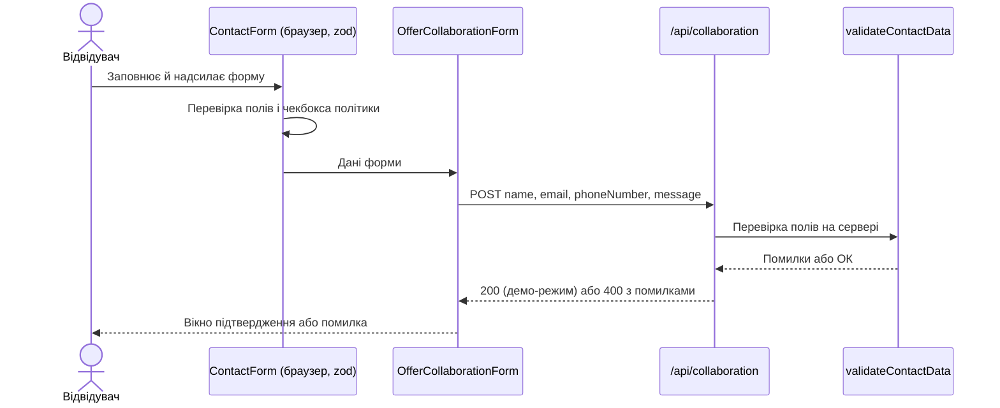

# Контактна форма: аналіз фічі і зміни (приклад)

> ЗАПАСНИЙ ПРИКЛАД для дня 2. Складений за кодом шаблону lf-client, перевіреним вручну: файли `app/constants/validation.ts`, `app/lib/utils/validateContactData.ts`, `app/api/contact/route.ts`, `app/api/collaboration/route.ts`, `app/shared/components/forms/contact-form/ContactForm.tsx`, `app/shared/components/forms/offer-collaboration-form/OfferCollaborationForm.tsx`, `app/services/email/emailService.ts`. Номери рядків не вказано: вони змінюються. Узгоджено з поточною інструкцією Дня 2 (ID, три стани правил, AC із RULE-ID, питання з власниками). Читайте, перевіряйте за кодом і **додайте власні правки** (див. `fallback/uk/README.md`). Відповіді «замовника» нижче вигадані для симуляції (сценарій ментора).

## 1. Короткий опис і вихідний запит

Фонд отримує звернення відвідувачів через форму (ім'я, email, телефон, повідомлення, згода з політикою конфіденційності). Форма стоїть на сторінці «Контакти» та в блоці партнерства.

**Вихідний запит (issue, дослівно, не перезаписувати):**

> We want to tighten up the contact form. Phone number should be mandatory. We should also let visitors attach a document (CV or portfolio) when they write to us. Notifications need to reflect the new field.

**Що з'ясувалось у коді:**
- Телефон необов'язковий і на сервері, і в браузері.
- Вкладень немає ні у формі, ні в API.
- Лист-сповіщення не формується: `emailService` ніде не викликається, а API лише повертає «успіх» у демо-режимі.
- Форма на сторінці «Контакти» надсилає дані на `/api/collaboration`, а `/api/contact` не викликає жодна сторінка. У `GetNotesModal` та сама форма взагалі не звертається до API.

## 2. Бізнес-контекст (зі симуляції розмови із замовником)

Статус усіх рядків: **Agreed із симуляцією** (відповіді вигадані ментором; у реальному проєкті їх треба підтвердити).

| Що | Значення | Джерело |
|---|---|---|
| Ціль | Передзвонювати щодо прав на виконання творів: листи губляться | відповідь замовника |
| Метрика успіху | Частка звернень, на які відповіли за 2 робочі дні: зараз ≈50 %, ціль 90 % | відповідь замовника |
| NFR-01 (приватність) | Телефон і CV це персональні дані: зберігати не довше 6 місяців, доступ лише двом працівникам | відповідь замовника |
| NFR-02 (файли) | Лише PDF, до 5 МБ | відповідь замовника |
| NFR-03 (мови) | Помилки мовою інтерфейсу відвідувача | відповідь замовника |
| Не визначено | Перевірка файлів на віруси: замовник «не думав» → відкрите питання Q-07 | відповідь замовника |

## 3. User stories

1. **Як** відвідувач, **я хочу** вказати телефон, **щоб** фонд міг передзвонити мені.
2. **Як** відвідувач, **я хочу** прикріпити CV або портфоліо до звернення, **щоб** фонд одразу побачив мої матеріали.
3. **Як** працівник фонду, **я хочу** отримувати сповіщення з телефоном і посиланням на вкладення, **щоб** швидко опрацьовувати звернення.

## 4. Діаграма потоку даних

Примітка: у запиті немає поля `policy` (згода з політикою), сервер про неї не знає.

## 5. Таблиця правил (три стани)

Три стани: **«Є зараз»** (що робить код), **«Має бути»** (що вирішив бізнес) і **«Хто вирішив»**. Порожнє «Має бути» означає, що рішення немає: це питання, а не вигадка.

| ID | Правило | Файл | Джерело істини | Шар | Є зараз | Має бути | Хто вирішив |
|---|---|---|---|---|---|---|---|
| RULE-01 | Ім'я | `validation.ts`, `validateContactData.ts`; `ContactForm.tsx` | константа / число в схемі zod | API і UI | 2–50 символів, `maxLength 50` | без змін | не зачеплено запитом |
| RULE-02 | Email | `validateContactData.ts` (`EMAIL_PATTERN`); `ContactForm.tsx` (`.email()`) | регулярний вираз / схема zod | API і UI | **два різні правила** | ? | відкрито, Q-09 |
| RULE-03 | Телефон | `validateContactData.ts` (`PHONE_NUMBER_PATTERN`); `ContactForm.tsx`, `normalizePhoneNumberFromMask` | регулярний вираз і константи / схема zod | API і UI | необов'язковий; якщо є, то `+` і цифри, 11–16 | обов'язковий; формат без змін | замовник (issue); для `GetNotesModal` ? (Q-04) |
| RULE-04 | Повідомлення | `validation.ts`, `validateContactData.ts`; `ContactForm.tsx`, `i18n/messages` | константа / числа в схемі й у перекладах | API і UI | 10–1000 символів | без змін | не зачеплено запитом |
| RULE-05 | Згода з політикою | `ContactForm.tsx` | схема zod | **лише UI** | обов'язкова в браузері, сервер про неї не знає | ? | відкрито, Q-08 |
| RULE-06 | Вкладення | нових файлів немає (`upload.ts` лише демо-заглушка) | немає | UI, API, сховище | немає | необов'язковий, лише PDF, до 5 МБ | замовник (симуляція); сховище, віруси, приватність відкриті (Q-01, Q-02, Q-07, Q-10) |
| RULE-07 | Сповіщення про звернення | `emailService.ts` (не викликається) | заготовка | API, зовнішній сервіс пошти | лист не формується | містить телефон і посилання на вкладення | issue; канал і одержувач відкриті (Q-03) |
| RULE-08 | Приймання запиту | `app/api/collaboration/route.ts` | жорстко закодований текст | API | «успіх» у демо-режимі, нічого не зберігається | ? | відкрито |
| RULE-09 | Стан кнопки «Надіслати» | `ContactForm.tsx` (`disabled`) | властивість компонента | UI | вимкнена лише на час відправки | ? | відкрито, Q-05 |
| RULE-10 | Обмеження частоти запитів | `app/api/*` | немає | API | у переглянутих файлах не знайдено | ? | відкрито, Q-06 |
| RULE-11 | Повідомлення про максимальну довжину | `useAutoHideMessage` | хук | UI | зникає автоматично | без змін | не зачеплено запитом |

## 6. Критерії приймання (для зміни з issue)

Формат: `AC-NN | Given … When … Then … | RULE-ID`. Числові межі (PDF, 5 МБ) беремо з розмови із замовником; усе, чого він не визначив, винесено у відкриті питання. Кожен AC описує **нову** поведінку та проходить лінтер AC (атомарність, один результат, без реалізації й розмитих слів, тестованість).

1. **AC-01** | **Given** форма відкрита, **When** користувач залишає телефон порожнім і натискає «Надіслати», **Then** показується помилка «телефон обов'язковий» і запит не відправляється. | RULE-03
2. **AC-02** | **Given** телефон введено у хибному форматі (без `+` або коротше 11 символів), **When** користувач надсилає форму, **Then** показується помилка формату телефону. | RULE-03
3. **AC-03** | **Given** телефон введено правильно, **When** користувач надсилає форму, **Then** запит відправляється. | RULE-03
4. **AC-04** | **Given** користувач вибрав PDF до 5 МБ, **When** він надсилає форму, **Then** вкладення передається разом із запитом. | RULE-06
5. **AC-05** | **Given** користувач вибрав файл понад 5 МБ, **When** він його вибирає, **Then** показується помилка про розмір і файл не додається. | RULE-06
6. **AC-06** | **Given** користувач вибрав не PDF, **When** він його вибирає, **Then** показується помилка про тип файлу. | RULE-06
7. **AC-07** | **Given** файл не вибрано, **When** користувач надсилає форму, **Then** запит відправляється без вкладення. | RULE-06
8. **AC-08** | **Given** згода з політикою не поставлена, **When** користувач натискає «Надіслати», **Then** форма не відправляється. | RULE-05
9. **AC-09** | **Given** форма відправляється, **When** запит ще виконується, **Then** кнопка «Надіслати» вимкнена до завершення запиту. | RULE-09 (поведінку для невалідних полів визначає Q-05)
10. **AC-10** | **Given** звернення успішно прийняте, **When** фонд отримує сповіщення, **Then** воно містить телефон і посилання на вкладення. | RULE-07 (канал визначає Q-03)
11. **AC-11** | **Given** інтерфейс українською або англійською, **When** показується помилка, **Then** вона написана мовою інтерфейсу. | RULE-03, RULE-06, NFR-03
12. **AC-12** | **Given** вкладення збережено понад 6 місяців тому, **When** запускається очищення, **Then** файл видалено. | RULE-06, NFR-01 (механізм визначає Q-02)

> Що виправлено лінтером: у чернетці AC-09 і AC-10 описували поточну поведінку («зараз кнопка…», «зараз лист не формується»); тепер вони описують нову поведінку, а поточний стан лежить у таблиці правил (RULE-07, RULE-09).

## 7. Таблиця ключових файлів

| Файл | Навіщо |
|---|---|
| `app/shared/components/forms/contact-form/ContactForm.tsx` | Форма й правила в браузері |
| `app/shared/components/forms/offer-collaboration-form/OfferCollaborationForm.tsx` | Надсилає дані на `/api/collaboration` |
| `app/api/collaboration/route.ts` | Приймає запит із форми (демо) |
| `app/api/contact/route.ts` | Така сама перевірка, але його ніхто не викликає |
| `app/lib/utils/validateContactData.ts` | Правила на сервері |
| `app/constants/validation.ts`, `app/constants/errors.ts` | Межі й тексти помилок сервера |
| `app/services/email/emailService.ts` | Заготовка листа, ніде не використовується |
| `app/services/upload/upload.ts` | Демо-заглушка завантаження |
| `i18n/messages/en.json`, `uk.json` | Тексти помилок і підписів |

## 8. Відкриті питання до стейкхолдера

Формат: `Q-NN | питання | чому блокує | власник (роль) | до якої дати | пов'язане`. Дати орієнтовні: у реальному проєкті їх узгоджує аналітик із замовником.

| ID | Питання | Чому блокує | Власник (роль) | До дати | Пов'язане |
|---|---|---|---|---|---|
| Q-01 | Куди зберігається вкладення (диск, хмарне сховище, лише лист)? | без цього не спроєктувати завантаження й посилання | технічний лід | до початку розробки | RULE-06, AC-04, AC-10 |
| Q-02 | Як реалізувати вимоги приватності: зберігання до 6 місяців, доступ двом працівникам? | юридичний ризик, впливає на сховище | відповідальний за персональні дані | до початку розробки | NFR-01, AC-12 |
| Q-03 | Кому і яким каналом надсилається сповіщення? | не визначено одержувача | керівник відділу звернень | до початку розробки | RULE-07, AC-10 |
| Q-04 | Чи обов'язковий телефон також у `GetNotesModal`, чи лише на «Контактах»? | змінює обсяг робіт | власник продукту | до початку розробки | RULE-03, AC-01 |
| Q-05 | Чи має кнопка бути вимкненою, поки поля невалідні? | впливає на AC-09 | UX-дизайнер | до дизайн-рев'ю | RULE-09, AC-09 |
| Q-06 | Чи потрібен захист від спаму й обмеження частоти запитів? | відкритий ризик | технічний лід | до початку розробки | RULE-10 |
| Q-07 | Чи перевіряти файли на віруси? (замовник «не думав») | безпековий ризик | безпека / технічний лід | до початку розробки | RULE-06 |
| Q-08 | Чи перевіряти згоду з політикою також на сервері? | зараз її обходить прямий запит до API | юрист / власник продукту | до початку розробки | RULE-05, AC-08 |
| Q-09 | Чи мають формат email у формі й на сервері збігатися? | зараз два різні правила | технічний лід | до початку розробки | RULE-02 |
| Q-10 | Що робити, якщо завантаження файлу обірвалося? | немає поведінки для збою | UX-дизайнер | до дизайн-рев'ю | RULE-06 |
