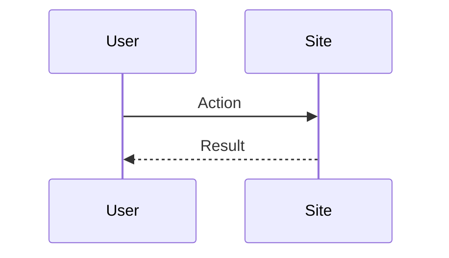

# Template C. Modular OpenSpec / BMAD style

Use **modules** or **packages** with IDs. Each block should be self-sufficient for traceability.

---

## Package metadata
| Field | Value |
|-------|-------|
| Package ID | PKG-NEW-001 |
| Capability | |
| Status | Discovery |
| Owner | |

---

## Module 1. Mission and outcome (BMAD style)
**Mission:**  
**Desired outcome:**  
**Success criteria:**

| ID | Criterion | Observable signal |
|----|-----------|-------------------|
| SC-01 | | |

---

## Module 2. Scope (OpenSpec style)
### In scope
| ID | Item |
|----|------|
| IN-01 | |

### Exclusions
| ID | Exclusion | Reason |
|----|-----------|--------|
| OUT-01 | | |

---

## Module 3. Actors and flow
| Actor | Role |
|-------|------|
| | |

---

## Module 4. Business rules (verifiable)
| ID | When | Then | Else |
|----|------|------|------|
| RULE-01 | | | |
| RULE-02 | | | |

---

## Module 5. Constraints and dependencies
| ID | Type | Description |
|----|------|-------------|
| DEP-01 | | |
| CON-01 | Legal / policy | |

---

## Module 6. Assumptions and open questions
| ID | Assumption | Verification plan |
|----|------------|-------------------|
| ASM-01 | | |

| ID | Question | Stakeholder |
|----|----------|-------------|
| Q-01 | | |

---

## Traceability matrix (starter)
| Rule ID | Related AC / story | Test idea |
|---------|--------------------|-----------|
| RULE-01 | | |

---

**Reflection:** Which module was first to reveal gaps about **data retention** or **stakeholder promises**? Could a designer read only Module 3 and still align?
